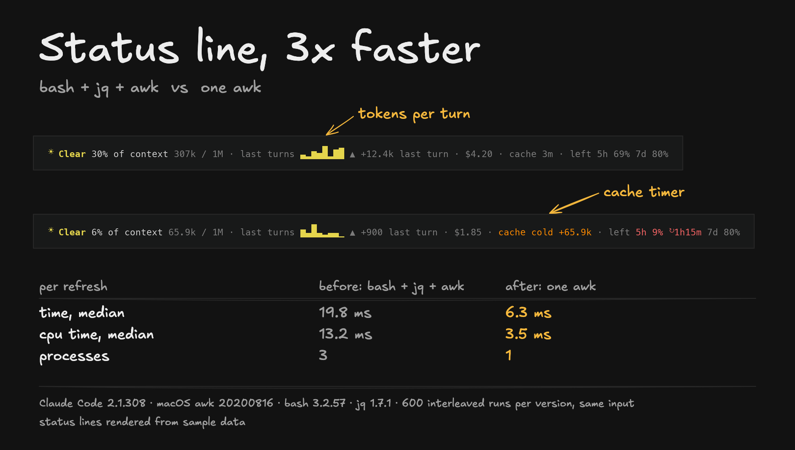

# statusline

A Claude Code status line in a single awk process: no bash, no jq.



```
☀ Clear 30% of context 307k / 1M · last turns ▁▁▃█ ▲ +12.4k last turn · $4.20 · cache 3m · left 5h 69% 7d 80%
```

## What it shows

- **Context use**: percent of the window and tokens in use, with a label that turns from Clear to Filling, Tight and Full at 50%, 70% and 85%.
- **Growth per turn**: a sparkline of how many tokens each of the last turns added, and the last turn's change.
- **Session cost.**
- **Prompt cache timer**: `cache 3m` while the cache is warm (orange in the last minute). Once it has expired, `cache cold +307k`: the next message re-writes that many tokens to the cache, which costs more than reading them.
- **Rate limits**: what is left of the 5-hour and 7-day windows, and when one runs low (25% or less), when it resets: `5h 9% ↻1h15m`.
- In terminals under 100 columns, the labels are dropped and the bars stay.

## Why one awk process

Claude Code runs the status line command after every message, on mode changes, and on `refreshInterval`. A new run cancels one still in progress, and slow scripts delay updates. The usual pattern, a bash script that pipes the JSON into jq and then formats it, starts three processes each time.

Measured with [bench/bench.py](bench/bench.py) (600 runs each, interleaved, same input):

| per refresh | bash + jq + awk | one awk |
|---|---|---|
| time, median | 19.8 ms | 6.3 ms |
| cpu time, median | 13.2 ms | 3.5 ms |
| processes | 3 | 1 |

[bench/parity.py](bench/parity.py) checks that both print the same line and keep the same state over 480 random states.

## Install

1. Copy the script:
   ```sh
   curl -fsSL https://raw.githubusercontent.com/selimaytac/claude-code-kit/main/statusline/statusline.awk -o ~/.claude/statusline.awk
   ```
2. Add this to `~/.claude/settings.json`:
   ```json
   "statusLine": {
     "type": "command",
     "command": "awk -f ~/.claude/statusline.awk",
     "refreshInterval": 30
   }
   ```
   `refreshInterval` keeps the cache timer moving between messages.

It works with the awk that ships with macOS and with gawk/mawk on Linux. Per-session readings for the sparkline are kept in `~/.claude/statusline-state/` and files older than a week are removed.

## Run the benchmark yourself

```sh
cd statusline/bench
python3 parity.py
python3 bench.py 600
```
